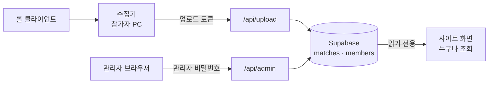

# 컴학내전 (KNUCSE LoL)

경북대학교 컴퓨터학부 롤 내전 기록·통계 사이트입니다.
내전이 끝나면 참가자 PC의 **수집기**가 결과를 자동으로 올리고, 사이트에서 선수·챔피언·포지션 통계와 **팀 짜기(팀 밸런스)**를 볼 수 있습니다.

| | 주소 |
|---|---|
| 사이트 | https://knucse-lol.vercel.app/group/main |
| 관리 화면 (관리자) | https://knucse-lol.vercel.app/group/main/admin |
| 상태 점검 | https://knucse-lol.vercel.app/api/health |

## 누가 무엇을 읽으면 되나

| 나는… | 읽을 문서 |
|---|---|
| 내전 참가자 — 사이트 보는 법, 수집기 설치 | [docs/사용법.md](docs/사용법.md) · [collector/README.md](collector/README.md) |
| 사이트 관리자 — 배포, 백업, 기록 정리 | [docs/운영.md](docs/운영.md) |
| 점수·팀 짜기·중복 판정이 어떻게 계산되는지 궁금 | [docs/동작원리.md](docs/동작원리.md) |
| 지금까지 무엇을 했고 데이터를 어떻게 정리했는지 | [docs/작업기록.md](docs/작업기록.md) |
| 코드를 고치려는 개발자 | [docs/개발.md](docs/개발.md) |

## 기능

- **매치 기록** — 경기별 KDA·CS·골드·딜량·시야·밴, MVP/ACE
- **통계 탭** — 선수별 성적(리더보드), 챔피언 승률, 포지션별 순위, 진영별 통계, 듀오 상성, 선수 정보
- **팀 밸런스** — 참가자 10명을 고르면 가능한 편성을 모두 비교해 가장 균형 잡힌 팀과 포지션을 추천 (다른 조합 보기, 두 사람 같은 팀/다른 팀 고정, 최근 경기와 같은 팀 피하기)
- **수집기 (Windows)** — 롤 클라이언트에서 내전 결과를 읽어 자동 업로드. 로그인 시 자동 실행, 로컬 백업, 실패분 자동 재전송, 과거 내전 추출
- **관리** — 백업 내려받기·복원, 경기 자료 가져오기(중복 자동 처리), 아이디 통합, 경기 기록 제외(예: *Zeus's Law*), 수동 등록

## 현재 데이터 (2026-11-17 기준)

| 기간 | 경기 수 | 출처 |
|---|---|---|
| 2026-06-04 ~ 07-02 | 28 | 예전 사이트(naejeon.lol)의 수기 기록 복원 — 딜량·시야 등은 미수집 |
| 2026-07-03 ~ 09-11 | 0 | **기록 없음** (참가자 클라이언트 전적으로 채울 수 있음) |
| 2026-09-12 ~ 11-16 | 23 | 롤 클라이언트 과거 전적 추출 (상세 지표 포함) |

총 51경기 중 1경기(10/26 *Zeus's Law*)는 통계에서 제외, 선수 25명. 자세한 정리 내역은 [작업기록](docs/작업기록.md#데이터-정리-내역).

## 구성



- 조회는 누구나, 기록 수정은 **관리자 비밀번호**, 수집기 업로드는 **업로드 토큰**으로 권한이 나뉩니다.
- 기술: Next.js 16 · TypeScript · Tailwind · Supabase · Vercel · Python 3(수집기, 표준 라이브러리만)

## 저장소 구조

```
src/app/                 화면(group/main …)과 API(api/admin · upload · collector · health)
src/components/          탭·카드·모달 등 화면 구성 요소
src/lib/                 통계·점수·팀 밸런스(stats, mvp) · 자료 해석·중복 판정(import-parse, ingest-plan)
src/lib/server/          서버 전용: 인증, DB 쓰기, 가져오기, 관리 작업
supabase/                DB 설정 SQL (01 스키마 → 02 28경기 복원 → 03 기록 제외)
collector/               Windows 수집기 (Python)
data/legacy/             28경기 원본 JSON
scripts/                 SQL 생성·검증, 로컬 확인 도구(가짜 DB, 화면 점검)
docs/                    문서
```

## 출처

[im-in-J/naejeon](https://github.com/im-in-J/naejeon) (예전 사이트 `naejeon-nine.vercel.app`)을 기반으로 다시 만들었습니다.
이 저장소의 이전 프로젝트(`MakeupTeam/` 노트북)는 커밋 `8b37a47` 에 남아 있습니다.
